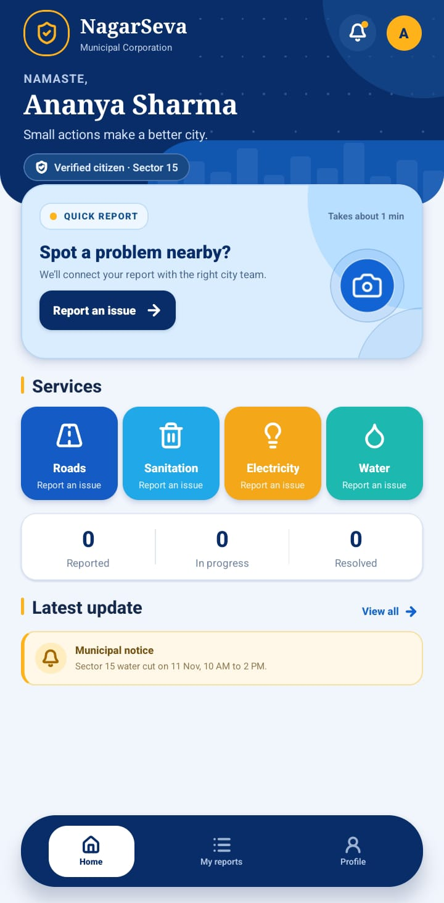
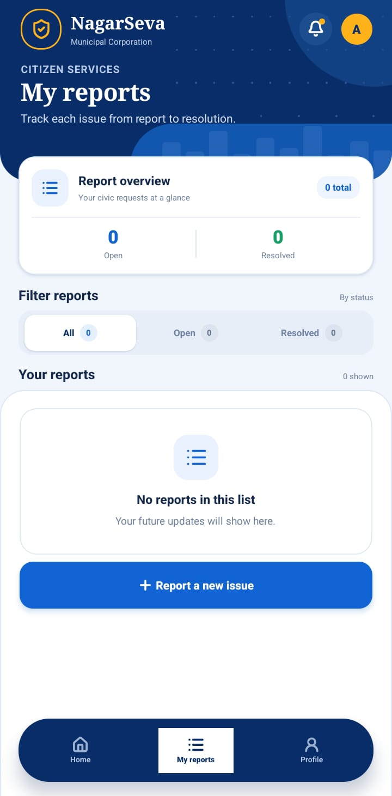
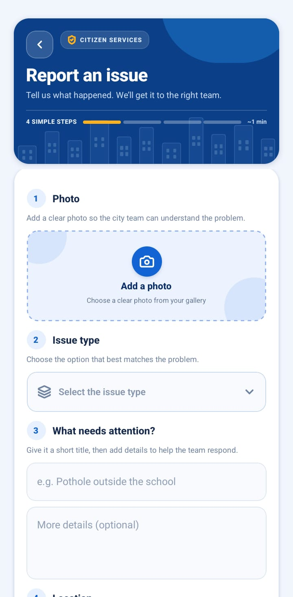
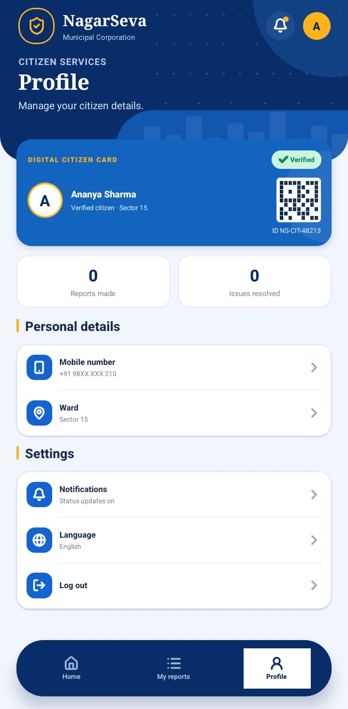

# NagarSeva

**NagarSeva** is a citizen-services mobile app concept for reporting municipal issues and tracking them through resolution. Citizens can submit reports from the app; a government authority workflow is represented by a separate, protected database table for staff-side processing.

> **Project status:** Mobile screens and the Supabase data/storage integration are in place. Before report submission can work against a Supabase project, anonymous sign-ins must be enabled for that project. They are currently disabled on the linked project, so enable them before a live demo. The government authority web dashboard is not included in this repository.

## App preview

The screenshots below are the supplied NagarSeva screen previews and are stored in this repository so reviewers can open them directly.

| Home | My reports |
| --- | --- |
|  |  |

| Report an issue | Profile |
| --- | --- |
|  |  |

### Launch screen


## Features

- **Home dashboard:** quick report entry, municipal service categories, report counts, and city notices.
- **Issue reporting:** choose a category, enter a short issue title and details, and select a photo from the device gallery.
- **Photo storage:** selected images upload to the private Supabase Storage bucket `report`, under `UserReport/<citizen-user-id>/`. The saved object path is recorded in `UserReport.image_urls`.
- **Issue tracking:** citizens can view their reports and follow status changes. Feedback about a resolution is recorded for the authority workflow.
- **Citizen profile data:** profiles are linked to Supabase Auth users and include contact, address, and identity-verification fields.
- **Branded launch experience:** a NagarSeva logo and launch screen are configured for Android and iOS, followed by an animated in-app splash.

## Technology

- React Native CLI 0.88
- React 19
- Supabase Auth, Postgres, Realtime, and Storage
- `react-native-image-picker` for gallery selection
- `react-native-config` for local environment variables
- `react-native-safe-area-context`, `react-native-svg`, and Lucide icons

## Project structure

```text
.
├── App.js                         # App state, navigation flow, and report submission
├── src/
│   ├── Components/                # Shared UI components and branding
│   ├── Navigation/                # Screen navigation and layout
│   ├── Screens/                   # Home, Report, My reports, Profile, splash
│   └── lib/                       # Supabase client and complaint operations
├── assets/                        # NagarSeva logo source artwork
├── android/                       # Android icon and native launch screen
├── ios/                            # iOS app icon and launch screen
└── supabase/
    ├── config.toml
    └── migrations/                # Profiles, reports, triggers, and storage policies
```

## Run locally

### Requirements

- Node.js **22.11 or newer**
- npm
- Android Studio, Android SDK, and an emulator or Android device for Android builds
- macOS with Xcode and CocoaPods for iOS builds

See the [React Native environment setup guide](https://reactnative.dev/docs/set-up-your-environment) for platform-specific setup.

### 1. Install packages

```sh
npm ci
```

### 2. Configure Supabase

Copy `.env.example` to `.env` in the repository root and set the project URL and **publishable** key:

```dotenv
SUPABASE_URL=https://your-project-ref.supabase.co
SUPABASE_PUBLISHABLE_KEY=sb_publishable_your_key
```

The `.env` file is ignored by Git. Do not put a Supabase `service_role` or secret key in the mobile app.

Enable **Anonymous Sign-Ins** in the Supabase Dashboard under **Authentication → Sign In / Providers → Anonymous**. The mobile client uses a persisted anonymous citizen session until a full citizen verification/sign-in flow is added. Anonymous profiles start with `verification_status = 'unverified'`.

### 3. Apply database migrations

Create or select a Supabase project, link the CLI, and push the migrations:

```sh
npx supabase login
npx supabase link --project-ref YOUR_PROJECT_REF
npx supabase db push --linked
```

The migrations create the report/profile tables, RLS policies, status and feedback triggers, and the private report-image bucket. Review `supabase/config.toml` and the CLI config diff before pushing configuration changes. The migrations are in `supabase/migrations/`.

### 4. Start the app

Start Metro in one terminal:

```sh
npm start
```

In another terminal, build and run Android:

```sh
npm run android
```

For iOS on macOS, install pods after cloning or changing native dependencies, then run:

```sh
bundle install
cd ios
bundle exec pod install
cd ..
npm run ios
```

After changing `.env`, Android native dependencies, app icons, or launch screen assets, rebuild the native app.

## Supabase data model

### `profiles`

One profile per Supabase Auth user. `profiles.id` references `auth.users.id`. Includes `full_name`, `email`, `phone_number`, `profile_image`, address fields, verification provider/status, and timestamps. A database trigger creates the profile when an Auth user is created. Citizens can update their own contact/profile fields; verification fields are reserved for trusted backend access.

### `UserReport`

Stores the citizen-submitted report:

| Column | Purpose |
| --- | --- |
| `id` | Report UUID primary key |
| `user_id` | Citizen profile ID |
| `Issue Type` | Short issue title from the form |
| `Description` | Selected issue category |
| `MoreDetail` | Optional longer description |
| `image_urls` | Storage object paths for uploaded report photos |
| `latitude`, `longitude` | Optional coordinates; not currently collected by the form |
| `location_address` | Report location; currently uses the form's default location |
| `complaint_number`, `status`, `citizen_feedback`, timestamps | Tracking and feedback fields used by the app |

The display-style column names with spaces and mixed capitalization are intentional and match the requested schema.

### `GovtReport`

One authority-side row per `UserReport`, created by a database trigger. Stores status, severity, priority score, department, assigned official ID, authority remarks, resolution notes/photos, citizen verification, feedback, and timestamps. It has row-level security enabled and is available to trusted server-side code using the service role. **Never expose the service-role key in a mobile app or public web client.**

### Report photo storage

- Bucket: `report` (private)
- Object path: `UserReport/<citizen-user-id>/<filename>`
- Accepted types: JPEG, PNG, and WebP
- Per-file limit: 5 MB
- Authenticated citizens can access only files under their own user-ID folder.

## Security and demo notes

- The mobile app uses only the Supabase URL and publishable key; row-level security protects citizen data.
- Anonymous sessions are **not** proof of a verified identity. The profile schema supports identity-verification status, but a provider integration is not implemented.
- The linked Supabase project's anonymous sign-in setting is currently disabled. Enable it before demonstrating report submission and photo upload.
- The current form uses a default location and does not collect latitude/longitude.
- The Profile screen and municipal notice use sample display content; profile editing and a live notice feed are not connected yet.
- The authority dashboard/API is a separate deliverable. Authority mutations must run server-side with controlled staff authentication.
- `.env` is local-only and must be configured separately on each machine.

## Useful scripts

| Command | Description |
| --- | --- |
| `npm start` | Start the Metro development server |
| `npm run android` | Build and launch on Android |
| `npm run ios` | Build and launch on iOS (macOS required) |
| `npm run lint` | Run ESLint |
| `npm test` | Run the Jest test script |

## License

No license has been added yet. Add a license before redistributing the project outside the hackathon submission.
